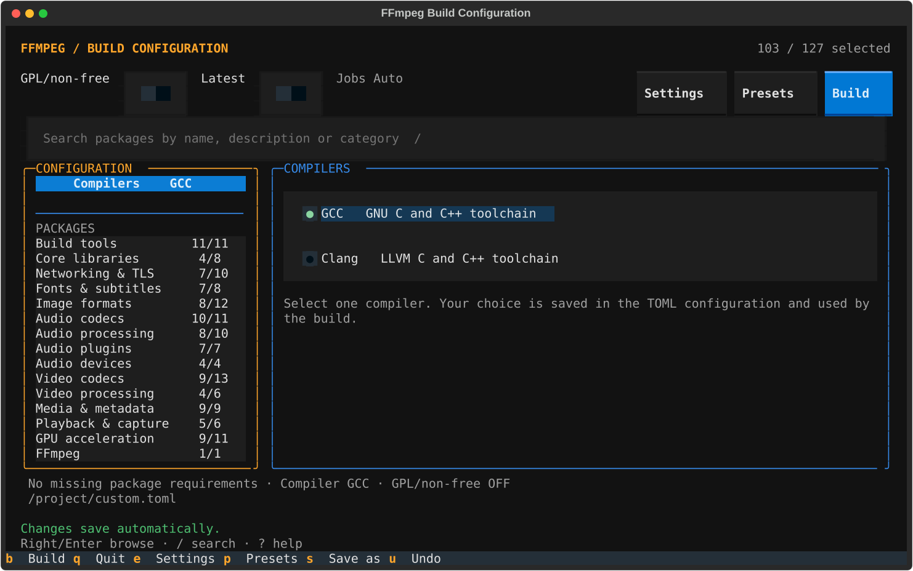

# FFmpeg Build Script

A safety-focused, state-pinned FFmpeg source build for modern Debian and Ubuntu
systems. It builds a broad multimedia dependency stack into an isolated
workspace, configures FFmpeg from the latest stable release, installs FFmpeg
under `/usr/local`, and validates the installed binaries before marking the
build complete.

The project favors static dependency archives, but the final binary can still
link dynamically to selected operating-system libraries and GPU runtimes.

## Latest changes (since 8.1.0)

- **Takeover also stops workers whose parent already exited.** Every command
  runs in a process group of its own, and the takeover stops and kills each of
  those groups too. A build in the middle of a privileged step (APT, CUDA or
  the FFmpeg install) is never interrupted; the new build names the PID to wait
  for or stop instead.
- **An unfinished FFmpeg install blocks every build root.** The programs a
  promotion replaces are saved to
  `/usr/local/share/ffmpeg-build-script/previous-install/` instead of the build
  root, so every workspace and user waits until a failed restore is put back.
  Cancellation waits until every program has been restored, and the reuse
  checks and closing summary read `/usr/local` only under its install lock.
- **Rebuilds keep their releases.** A package being rebuilt records its release
  in `packages/<package>.pin`, so packages rebuilt because a dependency changed,
  and a rebuild interrupted part-way, resume at the releases they had instead of
  upgrading. Rebuilding rav1e, x265 or libaom also rebuilds libheif, and
  rebuilding zlib, libpng or libjpeg-turbo rebuilds what links them.
- **WSL2 kernels older than 5.10** (`-microsoft-standard`, without `WSL2`) are
  no longer refused as WSL1, and a pre-release Python in the Conda environment
  is skipped in favour of a stable one.
- **Conda is optional.** The launcher uses an existing `install-ffmpeg` Conda
  environment, and otherwise the newest compatible system Python, without
  invoking Conda. It offers to create the environment only when no Python 3.12
  or newer is available. An environment that is too old, or whose version
  cannot be read, is reported and skipped instead of stopping the launcher.
- **pkg-config falls back to freedesktop.org pkg-config.** The workspace
  resolver is still pkgconf, now downloaded as its uploaded `.tar.xz` release
  and built with Meson, since pkgconf drops Autotools in 3.1. When pkgconf
  cannot be downloaded, freedesktop.org pkg-config is built from its newest
  commit instead. Every recipe and FFmpeg call the resolver `pkg-config`, so
  FFmpeg is reconfigured once.
- **x265 comes from its official Bitbucket repository** when that repository
  has the newest release, and from the GitHub mirror otherwise. The newest
  release on either host is built, and the installed `x265.pc` and library now
  report that release; Git archives named an older one, such as 4.2 for 4.3.
  Workspaces carrying the wrong label rebuild x265 once.
- **Choose the CPU the build is optimized for.** `--cpu-target` (or
  `cpu_target` in `[build]`, or `t` in the menu) takes `native`, the default
  and fastest, or a portable target: `generic` runs on any x86-64 CPU and
  `x86-64-v2`, `-v3` or `-v4` on any CPU with that instruction-set level.
  `--generic` is short for `--cpu-target generic`. FFmpeg, every C/C++
  dependency, rav1e's Rust code and GMP follow it. A level this CPU cannot run
  is rejected before anything is installed.
- **A workspace reused on a different CPU is detected.** A native build records
  the CPU it was tuned for (model and instruction-set extensions), so moving the
  workspace to another CPU asks for `--cleanup` instead of reusing code that can
  crash there. Existing native workspaces are adopted once as built on this
  CPU; rav1e is rebuilt so its Rust code is tuned too, and FFmpeg is relinked.
- **The build reports the machine it runs on**: CPU model and instruction-set
  level, the CPU the compiler resolves `-march=native` to, available memory,
  the distribution with its point release and kernel, and each GPU's model and
  NVIDIA driver version. The default job count now also respects a container's
  CPU quota and keeps 2 GiB of free memory per job; `--jobs` still overrides
  it, and rav1e's Cargo build follows it.
- **The closing summary counts FFmpeg 9's filters.** FFmpeg 9 lists two flag
  columns instead of three, so the summary reported 0 filters.
- **The build log keeps the lines printed before the build banner**, such as
  the loaded config and why a workspace was adopted or will rebuild rav1e and
  FFmpeg. A run stopped by those checks still leaves the previous log untouched.
- **SVT-AV1 always includes its AVX-512 kernels.** They are compiled with their
  own flags and used only on CPUs that have AVX-512, so leaving them out on
  other build machines only made those builds less capable elsewhere.
- **A finished FFmpeg build is reconfigured when the host changes.** The build
  records the exact options FFmpeg was configured with
  (`packages/ffmpeg.configured`). Before reusing that build, it works out the
  options this run would use and rebuilds FFmpeg if they differ, for example
  when a system library such as dav1d or a CUDA toolkit was installed since. The
  warning names the options added and dropped. Workspaces without this record
  rebuild FFmpeg once; dependency builds are still reused.
- **Commands no longer run in the directory you started the build from.** A
  command that needs no particular directory now runs in `/`, so a Git
  repository, `.cargo/config.toml` or Python module there can no longer
  affect the build. Before, a Git `insteadOf` rule in that directory redirected
  release lookups to another host.
- **HTTPS inputs work in GPL/non-free builds.** OpenSSL was configured with a
  certificate directory inside the workspace that was never created, so
  FFmpeg, which verifies TLS certificates by default, rejected every HTTPS
  server. OpenSSL now uses the system's `/usr/lib/ssl`, and an existing
  workspace rebuilds OpenSSL, its dependents and FFmpeg once.
- **Configure no longer stops on a too-old system library.** The build reads
  each library's minimum version from the configure script of the FFmpeg release
  being built and leaves out, with a warning, a system library older than that.
  Ubuntu 22.04's dav1d and Debian 13's libplacebo are both too old for FFmpeg 9.
- **The CUDA toolkit is offered only to builds that can use it**: with
  `--enable-gpl-and-non-free` and `nv-codec-headers = true`. A toolkit installed
  during a build now also reconfigures FFmpeg, which otherwise reused a build
  made without it. On WSL2, `nvidia-smi` stays on the build path after that
  install.
- The menu's compact and narrow layouts now follow every terminal resize,
  including one made while a dialog is open.
- `libaribb24` is marked as needing GPL authorization in the menu and the
  closing summary, since FFmpeg accepts the version every supported release
  ships only with `--enable-gpl`.
- **Existing workspaces rebuild FFmpeg once.** The build now records a SHA-256
  fingerprint of the programs it installs in `/usr/local/bin` and reuses a
  finished FFmpeg build only while they still match, so a different FFmpeg
  installed over them, even of the same version, is rebuilt instead of being
  reported as verified. Workspaces from before this change have no fingerprint
  yet; dependency builds are still reused.
- **VapourSynth and AviSynth build only their headers.** FFmpeg loads
  `libvapoursynth-script.so` and `libavisynth.so` when a `.vpy` or `.avs` file
  is opened, so those inputs work only after you install that library on the
  system. The closing summary names the library for each integration enabled.
  These builds are now much shorter and no longer need Cython.
- **sudo never waits at a hidden password prompt.** Privileged commands run as
  `sudo -n`. If the cached password expires during a long build, you are asked
  again before FFmpeg is installed; a policy requiring a password for every
  command fails promptly instead of hanging.
- Pressing Ctrl-C again during a failed installation's rollback no longer
  leaves programs half-restored.
- `--cleanup` no longer reaches into other build directories inside the
  checkout, and deletes an old `packages/`, `workspace/` or
  `ffmpeg-build-script/` directory only when it is verifiably this project's
  and not in use.
- Building Nettle without GnuTLS now asks for GMP, which Nettle needs.
- The cleanup prompt now lists what it deletes, with sizes and a plain
  description of each item, instead of a bare count of "build leftovers".
- **Cache folders in the checkout are deleted automatically** after every
  build and on `--cleanup`, without asking. The prompt now covers only the
  build folder and old build folders, and nothing inside a build root is ever
  counted as a cache.
  To keep them while you work on this repository, set
  `BYPASS_CACHE_DELETE=true` in your [settings file](#settings-file-env) or in
  the environment.
- **A settings file.** Every environment setting the script reads (build
  folder, debug output, CUDA, download, lookup and Git time limits, lock waits,
  the cache bypass) can be saved in a `.env` file beside the script.
  `.env.example` lists each one with what it does and its default; see
  [Settings file](#settings-file-env).
- Single-letter options can be grouped: `python3 build-ffmpeg.py -bln` is the
  same as `-b -l -n`, and `-bj8` the same as `-b -j 8`.

## Update: 8.1.0

- When Conda is available, builds always run in its `install-ffmpeg`
  environment; a system Python is used only on hosts without Conda. New
  environments use Python 3.14 from conda-forge, so no Anaconda Terms of
  Service acceptance is needed. Conda is found through `CONDA_EXE`, `PATH`,
  `~/miniconda3`, `~/miniforge3`, or `~/anaconda3`.
- Without Conda, the launcher picks the newest stable `python3` or `python3.N`
  that is Python 3.12 or newer, ignoring empty and relative `PATH` entries.
- Forced build-lock takeover works on Python builds that omit
  `signal.pidfd_send_signal`, including conda-forge's.
- The `dev` extra pins exact tool versions. Compatible 8.0.0 workspaces retain
  their built dependencies and reconfigure FFmpeg.

## Major update: 8.0.0

- The builder and diagnostic tools are now Python. The entry point is
  `build-ffmpeg.py`; the Bash scripts have been removed.
- `--menu` edits all 127 package choices, checks dependencies, saves a TOML
  configuration, and launches the build. Its Textual interface saves compiler
  and package choices immediately, with mouse and keyboard navigation.
- Python 3.12 or newer is required. Command-line builds use the standard
  library. The interactive menu uses Textual; development tools are optional.
- Compatible 6.0.0 and 7.0.0 workspaces retain their built dependencies and
  reconfigure FFmpeg. Changed compiler flags or package selections still
  require cleanup. The build-context format remains v2.
- Native build processes receive a clean environment so Conda's libraries,
  compilers, and package search paths cannot override the build toolchain.
  The build PATH keeps the conventional `/usr/local` before `/usr` order, so a
  compiler the administrator installed in `/usr/local/bin` is used, including
  through its ccache shim. After host setup, the log reports the selected C and
  C++ compiler version banners and executable paths, naming the compiler behind
  a ccache shim, using the same build environment as the recipes.
- FFmpeg retains its archive checks, release-dependent Vulkan integration,
  staged installation, and feature validation. Failed promotion or installed
  validation restores the previous programs and preserves recovery files.

## Requirements and supported hosts

- x86_64
- Debian 12 and 13
- Ubuntu 22.04, 24.04, and 26.04
- Any Ubuntu derivative declaring `ID_LIKE=ubuntu` whose `UBUNTU_CODENAME`
  is `jammy`, `noble`, or `resolute` (Linux Mint and Zorin among them)
- WSL2 using a supported Debian or Ubuntu userspace (WSL1 is not supported;
  convert with `wsl.exe --set-version <distro> 2`)

**Python 3.12, 3.13, and 3.14 are supported.** Ubuntu 22.04's default
Python 3.10 and Debian 12's default Python 3.11 cannot run the builder.

With `-C` or `--clear`, the launcher runs `clear` before anything else,
including `--help` and `--version`, so the output starts on an empty screen.
Without the option the terminal is never cleared. Redirected or piped output,
and a missing or `dumb` `TERM`, are left untouched even with it. If `clear` is
unavailable or fails, a warning is printed and the launcher continues.

Conda is optional. The launcher picks an interpreter in this order:

1. An existing `install-ffmpeg` Conda environment, which was created with your
   consent. The launcher finds Conda through `CONDA_EXE`, a `conda` command on
   `PATH`, or an installation at `~/miniconda3`, `~/miniforge3`, or
   `~/anaconda3`. An environment older than Python 3.12, or one whose version
   cannot be read, is reported with its remedy and skipped.
2. The newest stable `python3` or `python3.N` on `PATH` or in `/usr/bin`, or
   the interpreter running the launcher, that is Python 3.12 or newer. Conda is
   not invoked.
3. Only when neither exists and Conda is installed, the launcher asks before
   creating the environment with Python 3.14 from conda-forge, which needs no
   Anaconda Terms of Service acceptance, and installs Textual. Declining, or
   running without an interactive terminal, stops with the exact
   `conda create` command to run; no environment is created without consent.

To stop using an existing environment, remove it; the launcher then uses a
compatible system Python. The menu needs an interactive
terminal and Textual 8.2.8 or newer. Existing environments can install the menu
dependency with `~/miniconda3/envs/install-ffmpeg/bin/python -m pip install -e '.[menu]'`
from this checkout. A missing dependency produces an installation command for
the selected interpreter; ordinary builds do not import or require Textual.

Run the script as a normal user with working `sudo` access. Do not run the
entire script as root. The build also requires an internet connection and enough
free disk space for downloaded sources, intermediate objects, and installed
dependencies. Missing host build packages are installed with APT. On Ubuntu,
many optional feature packages come from the `universe` component, which is
enabled by default on standard images but may be absent from minimal ones
(`sudo add-apt-repository universe`).

## Quick start

```bash
git clone https://github.com/slyfox1186/ffmpeg-build-script.git
cd ffmpeg-build-script

# Keep the tracked template unchanged; edit the ignored working copy.
cp -- example.toml custom.toml

# Default LGPL-compatible build.
python3 build-ffmpeg.py --build --config ./custom.toml

# Or explicitly opt into GPL and non-free components.
python3 build-ffmpeg.py --build \
  --enable-gpl-and-non-free \
  --config ./custom.toml
```

`custom.toml` is the working configuration name used throughout this guide and
is ignored by Git. The tracked [example.toml](./example.toml) remains the
complete starting template.

The first build can take a long time and use substantial CPU, memory, and disk
space. Restrict parallelism on smaller machines:

```bash
python3 build-ffmpeg.py --build --jobs 8 --config ./custom.toml
```

## Command-line interface

```text

FFmpeg Build Script 8.1.0

Usage: python3 build-ffmpeg.py <action> [options]

  Builds FFmpeg and its libraries from source and installs FFmpeg under
  /usr/local. Run it as a normal user with sudo access. Choose exactly one
  action; with none, this help is shown.

Actions:
  -b, --build                     Build and install FFmpeg
  -m, --menu                      Pick packages in a menu, then build
  -c, --cleanup                   Delete the build root and temporary caches

Build options:
      --config <file>             Build only the packages this TOML file
                                  enables; start from example.toml
                                  (default: every package)
      --compiler <gcc|clang>      Compiler to use (default: gcc)
      --gcc, --clang              Same as --compiler gcc / --compiler clang
      --cpu-target <target>       CPU to optimize for: native, generic,
                                  x86-64-v2, x86-64-v3 or x86-64-v4; only
                                  generic and the levels run on other CPUs
                                  (default: native)
      --generic                   Same as --cpu-target generic
  -j, --jobs <count>              Parallel build jobs; the default keeps 2 GiB
                                  of free memory per job (default: usable CPUs)
  -l, --latest                    Check upstream for newer releases and rebuild
                                  outdated dependencies
  -n, --enable-gpl-and-non-free   Allow GPL and non-free components, required
                                  for x264, x265, fdk-aac and CUDA/NVENC; the
                                  result may not be redistributable

General options:
  -h, --help                      Show this help; changes nothing on disk
  -v, --version                   Show the script version
  -C, --clear                     Clear the terminal before anything else runs

  Options that take a value also accept --option=value, for example --jobs=8.
  Single-letter options can be grouped: -bln is -b -l -n, and -bj8 is -b -j 8.

Environment variables:
  BUILD_ROOT=<dir>                Build workspace
                                  (default: build/ in this checkout)
  CUDA_INSTALL=<mode>             Install a missing CUDA toolkit: ask, always or
                                  never (default: ask)
  CUDA_ARCH_MODE=<mode>           GPU code targets: native, all or custom
                                  (default: native)
  CUDA_ARCHITECTURES="<list>"     Targets for custom mode, for example "86 89"
  FFMPEG_BUILD_DEBUG=ON           Stream all command output to the terminal; the
                                  build log is still written (default: OFF)
  .env                            Every setting in .env.example can be saved in
                                  a .env file beside this script

Examples:
  # Build the packages enabled in your config (copy example.toml first)
  python3 build-ffmpeg.py --build --config ./custom.toml

  # Pick packages interactively, then build
  python3 build-ffmpeg.py --menu

  # Build with clang on 8 cores, including GPL and non-free components
  python3 build-ffmpeg.py --build --clang --jobs 8 --enable-gpl-and-non-free

  # Build a portable FFmpeg that runs on any x86-64-v3 (AVX2) CPU
  python3 build-ffmpeg.py --build --cpu-target x86-64-v3 --config ./custom.toml

  # Update outdated dependencies to their newest upstream releases
  python3 build-ffmpeg.py --build --latest --config ./custom.toml

  # Never install or modify CUDA packages
  CUDA_INSTALL=never python3 build-ffmpeg.py --build --config ./custom.toml

  # Start over with an empty workspace
  python3 build-ffmpeg.py --cleanup

Build log: $BUILD_ROOT/build.log    Full guide: README.md


```

`--help` and `--version` are side-effect free: they do not create a build
directory, truncate a log, request sudo, or load a config file.
On a terminal the help is colored; `NO_COLOR=1` turns color off, and piped or
redirected output stays plain unless `FORCE_COLOR=1` is set.

By default the result is tuned for the machine that built it
(`--cpu-target native`: `-march=native`, FFmpeg's `--cpu=native`, and rav1e's
`target-cpu=native`), so the installed binaries may fault with an illegal
instruction on a different CPU. To build for other machines, choose a portable
target: `--cpu-target generic` (any x86-64 CPU) or `x86-64-v2`, `x86-64-v3`
(AVX2) or `x86-64-v4` (AVX-512). Libraries that select SIMD code at run time,
including FFmpeg's own assembly, still use the fastest instructions the running
CPU offers. The build host must implement the chosen level, because the build
runs what it compiles.

The default job count is the number of usable CPU threads (the affinity mask,
reduced by a cgroup v2 CPU quota), capped so each job has 2 GiB of available
memory (also reduced by a cgroup v2 memory limit). The start of the build log
names the CPU, its instruction-set level, the CPU target, memory and the reason
for the job count.

With no action, the script prints help. `--build`, `--cleanup`, and `--menu`
are mutually exclusive. A build without `--config` selects every registered
package; using the reviewed `custom.toml` allowlist is the recommended path.

Bare invocation, help and version reporting do not resolve or create an
interpreter environment. An existing Conda environment older than Python 3.12
is reported with its removal command and skipped in favor of a compatible
system interpreter. Numeric settings accept ASCII
decimal digits; jobs, timeouts and counters are bounded to 2,147,483,647, while
byte limits may use the host's signed integer range. Empty environment timeout
overrides use the documented defaults.

Arguments are validated before any config file is read, so an invalid request
never applies a package selection. A relative `--config` path resolves against
the directory you ran the script from, never against the script's own
directory.

## Settings file (`.env`)

Settings you would otherwise type before the command, such as
`CUDA_INSTALL=never python3 build-ffmpeg.py --build`, can be saved once:

```bash
cp .env.example .env
```

Then open `.env`, delete the `# ` in front of each `NAME=value` line you want
to change, and edit its value. [`.env.example`](.env.example) lists every
setting with what it does, its allowed values and its default; every value
shown is the default, so a line uncommented unchanged changes nothing.

- `.env` sits next to `build-ffmpeg.py` and is ignored by Git.
- A variable set in the shell wins over `.env` for that run.
- Only the settings listed in `.env.example` are read. Any other line, such as
  a misspelled name or one that starts with `export`, is reported with its line
  number and ignored, so the file cannot change variables such as `PATH`.
- Values are checked exactly as if they had been exported; an invalid one stops
  the build before anything is installed. An unreadable `.env` stops the run.

## Interactive menu



```bash
python3 build-ffmpeg.py --menu
python3 build-ffmpeg.py --menu --config ./custom.toml
```

The menu reopens `custom.toml` in the invocation directory when it exists;
otherwise it starts from the portable template. `--config` selects a specific
file instead. Existing compiler, GPL/latest and package choices are preserved,
and invalid existing configs fail explicitly before editing. The menu opens on
**Compilers**, with **GCC** and **Clang** as visible choices. Select one with
Space or Enter; radio markers show the active compiler. A horizontal divider
separates Compilers from the package categories. In the wide view, Compilers
stays visible while the package categories scroll below it.

All 127 packages are grouped into 15 types. The Textual interface provides
scrolling lists, compiler radio buttons, GPL/latest switches, mouse selection,
search, and visible keyboard focus. Large terminals show categories and options
side by side. Narrow or short terminals show one pane at a time, with the same
navigation keys. The compiler category stays above a divider while packages
scroll beneath it. Counts include packages only.

| Key | Action |
| --- | --- |
| Up/down | Navigate the focused list; `k`/`j` also navigate the category list |
| Space or Enter | Select a compiler or toggle a package, then return to categories; Enter opens a category |
| Right | Focus the current category's options |
| Left / Escape / Backspace | Return to categories without changing a selection; stay there if already focused on a category |
| Tab / Shift-Tab | Move between controls |
| `a` / `d` | Enable or disable the entire package category, including hidden search matches |
| `/` | Focus live search by package name, description or category |
| `D` / `?` | Open full details or keyboard help |
| `p` | Choose template, all, minimal or none preset |
| `u` | Undo up to 50 package, category, preset, compiler, CPU target, GPL or latest changes |
| `c` | Open the Compilers category |
| `t` | Choose the CPU target: native or a portable level |
| `g` / `l` | Toggle GPL/non-free authorization or latest mode |
| `f` / `F` | Enable requirements for the current package or all packages |
| `e` | Edit jobs, CUDA installation/targets and build root for this session |
| `s` | Save as; subsequent edits auto-save to the chosen file |
| `i` | Import a TOML file into the current configuration; undo with `u` |
| `b` | Validate, save and build using the current configuration |
| `q` | Quit immediately; changes are already saved |
| Ctrl+C / Ctrl+D / Ctrl+Q | Exit from any screen |

Package toggles, compiler, CPU target and GPL/latest choices, category changes, presets,
dependency fixes and undo **save immediately** to the active TOML file. Each
write is atomic. If it fails, the attempted change is reverted and an error is
displayed, preserving the saved configuration and undo history. Saving allows
unfinished package selections; Build checks requirements before starting.
Browsing and searching do not rewrite the configuration.

Search updates while typing. Enter or Escape returns focus to categories and
keeps the filter; clear the text to show all packages. Arrow and Backspace keys
edit text normally inside input fields. Dialogs close with Escape, and launch
settings are validated before Apply accepts them. Invalid jobs, CUDA targets or
unsafe build roots retain the last accepted launch settings. Relative save/import
paths resolve from the invocation directory, and `~` expands in file and build paths.

In Save as, Up/Down switches between the path field and the Cancel/Save buttons.
Left/Right moves the text cursor in the path field or selects a button in the
button row. Returning to the buttons restores the last focused button; Enter
activates it. Tab and Shift+Tab also move between controls.

The Import button or `i` opens a file-path dialog with the same keyboard controls.
Import replaces all package selections and persistent build settings (compiler,
GPL/non-free and latest), then saves to the current autosave destination. Omitted
packages are disabled, just as with `--config`. Session-only launch settings stay
in place. Import validates the complete file before applying anything; read or
validation errors leave the current configuration untouched, and a failed autosave
rolls back the import. Press `u` to undo a successful import. The source file does
not become the autosave destination; use Save as to change that destination.

The minimal preset includes build tools and FFmpeg.

Textual handles terminal input and restores keyboard modes on exit. On terminals
supporting the Kitty keyboard protocol, Escape has an unambiguous encoding; older
terminals use Textual's legacy input handling. Ghostty and Kitty support the
extended protocol, but neither is required. The menu does not install its own
Escape timeout or require a second press. It runs `clear` after the terminal is
restored, including when a build starts or the menu exits through an error.

The saved `[build]` table contains `compiler`, `cpu_target`, `latest` and
`enable_gpl_and_non_free`. For example:

```toml
[build]
compiler = "clang"
cpu_target = "native"
latest = false
enable_gpl_and_non_free = true
```

Compiler precedence is an explicit CLI `--compiler gcc|clang` (or `--gcc` /
`--clang`), then the config, then GCC. Older configs without `compiler` retain
the GCC default; selecting a compiler in the menu saves it immediately. The CPU
target follows the same order: `--cpu-target` (or `--generic`), then the config,
then `native`. CLI
options initialize the menu; subsequent edits determine what is saved and
launched. The build reloads that saved file, so compiler, CPU target, licensing and
package choices match a later `--build --config ./custom.toml` invocation.
Jobs, CUDA settings and build root remain **session-only launcher options**;
the settings screen labels which values are saved.

Every menu exit runs `clear` after restoring the terminal, including save and
build, quit, Ctrl+C, Ctrl+D, terminal input loss and handled termination signals.
If `clear` is unavailable or fails, a warning is printed without losing the
saved configuration or masking the original error. Changing settings in a
previously built workspace still requires matching its recorded choices or
running `--cleanup` first; the editor never deletes build artifacts automatically.

The menu distinguishes packages waiting for GPL authorization, libraries that
build but whose FFmpeg integration needs GPL, and the GnuTLS stack suppressed
when GPL mode selects OpenSSL. Dependencies available from system packages
are shown as requirements to check, rather than unconditional selection
errors; the normal build verifies them against the host. The build's closing
summary also names selected FFmpeg integrations left inactive by GPL mode.

## Build state and version policy

The default build root is the repository's own `build/` directory, regardless of
where you run the script from. A `BUILD_ROOT` you set yourself is resolved
against the invocation directory instead:

```text
build/
├── .ffmpeg-build-context
├── .ffmpeg-build-root
├── build.log
├── packages/
│   ├── <downloaded archives>
│   ├── <archive>.sha256
│   ├── <extracted sources>
│   ├── <package>.done
│   └── <package>.pin       (only while a rebuild is unfinished)
└── workspace/
    ├── bin/
    ├── include/
    ├── lib/
    └── share/
```

Each successful component writes an atomic `.done` marker containing the exact
release version or Git commit used. A normal rerun reuses those versions and
does not contact every upstream service. `--latest` refreshes upstream versions
and rebuilds components whose recorded version changed. A component being
rebuilt, whether because its files are missing, a dependency it links was
rebuilt, or a previous run stopped part-way, keeps its release in
`<package>.pin` until it completes, so it is rebuilt at that release rather
than upgraded; `--latest` ignores pins.
Every source recipe discovers releases from upstream tags or release indexes;
there are no fixed release-version fallbacks. Git packages select stable release
tags and verify the checked-out commit, including annotated tags. x264 uses
upstream's `stable` branch because it does not publish ordinary release tags;
SDL2 stays within the SDL2 API family.
The workspace `pkg-config` is pkgconf at its newest release, downloaded as the
uploaded `.tar.xz` and otherwise as the tag snapshot of the same version. It is
built with Meson when the release declares Meson's search-path option, and with
Autotools before that. When neither pkgconf archive can be downloaded, or no
release can be found, freedesktop.org pkg-config is built from its newest
`HEAD` commit against the host GLib (`libglib2.0-dev`, installed when
available), and the commit is recorded as the version. The fallback does not
apply `Cflags.private` and matches field names such as `Libs.private` case
sensitively, so it can omit flags pkgconf emits. When a recorded
implementation's source is unavailable during a repair, the other one is
built and recorded; a configure or compile failure is never retried with the
other implementation. FFmpeg runs the resolver as `pkg-config`, which both
install, so workspaces configured with `pkgconf` reconfigure FFmpeg once,
whenever the FFmpeg source is available to check.
x265 builds the newest release tagged on either its official Bitbucket
repository or its GitHub mirror, downloading from Bitbucket when it carries
that tag and from GitHub otherwise or when the Bitbucket download fails. A
refresh that reaches only one host never replaces a newer recorded release
with an older one. The build records the selected release and its commit in
`x265Version.txt`, because Git archives carry a stale label there, and a
finished build whose `x265.pc` reports another release is rebuilt once. Until
a release contains upstream commit 98eec40, the build adds its `<cstdint>`
include to the HDR10+ JSON parser, which GCC 15's C++ headers otherwise leave
without `uint8_t` under both GCC and Clang. Until an FFmpeg release contains
upstream commit 9579983, the build applies its two-line `ffbuild/common.mak`
change to the extracted release; without it, a parallel out-of-tree build can
write `fftools/resources/graph.html.gz` before that directory exists and fail
with "Directory nonexistent". Only lines matching the unfixed text change, so a
release that contains the commit is left untouched. Rust, cargo-c, and NVIDIA's CUDA keyring
also resolve their current releases dynamically. Adopting dynamic Rust
tools rebuilds rav1e and FFmpeg while preserving other compatible dependencies.
System integrations use the distribution's APT packages; their versions follow
the configured distribution repositories. `All` selects every package and
reuses completed builds; `SKIP ... already built` means reuse, not deselection.
Missing installed artifacts are repaired from the recorded release or matching
Git checkout. LAME and SVT-AV1 archives must also pass a static link check before
reuse, so incomplete dependencies or incompatible LTO objects trigger a repair.
Meson is reused only while its launcher still runs, so a host Python upgrade
that strands its virtual environment rebuilds it in a fresh one.
LAME builds its encoder without the optional mpg123 decoder; SVT-AV1 builds
objects compatible with FFmpeg's host linker, for the selected CPU target.
A completed FFmpeg build is reused only while the programs in `/usr/local/bin`
match the SHA-256 receipt (`packages/ffmpeg.installed`) written when this
workspace installed them. Programs replaced by another build, even one of the
same version, trigger an FFmpeg rebuild; workspaces from earlier releases have
no receipt and rebuild FFmpeg once. Reuse also requires the configure options
this run would use to equal those recorded in `packages/ffmpeg.configured`. A
system library or CUDA toolkit installed since, or a library that is gone or
now too old, changes them and rebuilds FFmpeg.
If a recorded Git checkout is missing or points to another commit,
a normal rerun stops with recovery instructions; restore that checkout or use
`--latest` to select a fresh snapshot. It does not silently discard the pin.
Starting a rebuild invalidates that component's completion marker, the
registry's declared dependent components, and FFmpeg's marker before any recipe
writes. A failed upgrade is retried on resume, and FFmpeg is relinked against
rebuilt static dependencies. FFmpeg's own optional integrations follow the
configure receipt above. Dependency recipes are not re-probed: for changes to
optional dependencies detected by their upstream build systems outside the
registry's dependency rules, use a clean workspace to guarantee every optional
integration is reconfigured.

Use either an absolute or relative path for a separate build root:

```bash
# Absolute path
BUILD_ROOT=/mnt/fast-disk/ffmpeg-build \
  python3 build-ffmpeg.py --build --config ./custom.toml

# Relative to the directory where this command is invoked
BUILD_ROOT=./path/to/ffmpeg-build \
  python3 build-ffmpeg.py --build --config ./custom.toml
```

A relative `BUILD_ROOT` is resolved from the invocation directory, not from the
script's directory.

A successful build ends by calling cleanup. It first deletes the temporary
cache folders inside the checkout (`ffbuild/`, `__pycache__/`, `.mypy_cache/`,
`.pytest_cache/`, `.ruff_cache/`, `*.egg-info/`) without asking, since they are
recreated automatically when needed; the scan never enters a build root.
`BYPASS_CACHE_DELETE=true`, in the [settings file](#settings-file-env) or in
the environment, keeps them for developers of this repository. Cleanup then
interactively offers to delete the build root. Answer no to keep the
sources and workspace for a later incremental build; either answer ends with a
pointer to the project repository. Before asking, cleanup lists what a yes
deletes, with sizes and what each item is: the build root, and old
`packages/`, `workspace/` and `ffmpeg-build-script/` build folders from earlier
versions of this script when they are this project's own. `--cleanup` does the
same. The FFmpeg installed under `/usr/local`, tracked files, config files,
`.git/` and anything symlinked are never touched.

A custom, non-empty directory must already contain this project's
`.ffmpeg-build-root` marker. This prevents a typo from turning an unrelated
directory into a cleanup target. Build-root paths may not contain whitespace.
Use the same `BUILD_ROOT` value for later builds and cleanup.

## Package configuration

The config parser intentionally supports a small TOML subset:

```toml
[build]
compiler = "gcc"
cpu_target = "native"
latest = false
enable_gpl_and_non_free = false

[packages]
libopus = true
x264 = false
ffmpeg = true
```

Only `[build]` and `[packages]` are accepted. `compiler` must be the quoted
string `"gcc"` or `"clang"`, and `cpu_target` one of the quoted strings
`"native"`, `"generic"`, `"x86-64-v2"`, `"x86-64-v3"` or `"x86-64-v4"`; all
other values must be literal `true` or `false`.
Duplicate keys are rejected, and unknown package names are fatal.
With a config file, omitted package keys are disabled; the file is an explicit
allowlist. CLI opt-ins such as `--latest` and `--enable-gpl-and-non-free` take
precedence over a corresponding `false` build setting.
The licensing switch authorizes those components; it does not override
`[packages]` entries that remain `false`.

Start from [example.toml](./example.toml), which lists every supported package
key, and save changes in `custom.toml`. The build context records compiler and
flag choices, the CPU target (and, for `native`, the CPU it was tuned for),
licensing mode, CUDA targets, and package selections. If any of those inputs
change for an existing workspace, including moving a native workspace to a
different CPU, clean that workspace first:

```bash
python3 build-ffmpeg.py --cleanup
```

Cleanup asks before removing the validated build root. In a non-interactive
context it leaves the build root in place and deletes only the checkout's
cache folders. For an alternate root, run
`BUILD_ROOT=/same/path python3 build-ffmpeg.py --cleanup`.

The portable template leaves `libjxl` and `libshaderc` disabled because the
required `libjxl-dev` and `libshaderc-dev` packages are absent from Ubuntu
22.04's official repositories. They can be enabled on supported releases where
APT provides those development packages; an explicit selection fails clearly
instead of silently omitting an unavailable dependency. The system `libzix-dev`
package is similarly absent from Ubuntu 22.04 and Debian 12; keep the `zix`
source build enabled on those releases.

The template also disables `brotli`, `c-ares`, `freeglut`, `gflags`, `giflib`,
`jemalloc`, `libhwy`, `libsndfile`, `libtiff`, and `pcre2`. FFmpeg has no
configure option for any of them, and every component built here that could
consume one is configured with that consumer switched off, so they cost build
time and produce nothing linkable. `jemalloc` is the partial exception: FFmpeg
accepts `--custom-allocator=jemalloc`, which this script does not pass. Set any
of these keys back to `true` to restore the source build. `libpng` and
`libjpeg-turbo` stay enabled because GPAC probes for `-lpng` and `-ljpeg` and
links whichever copies the workspace provides.

Because an omitted key is disabled and an unknown key is a fatal error, these
keys remain supported rather than removed, so configs that list them keep
working.

`vapoursynth` and `avisynth` install only the headers FFmpeg compiles against.
FFmpeg loads `libvapoursynth-script.so` or `libavisynth.so` when a `.vpy` or
`.avs` input is opened, so those inputs work only on a host that provides that
library on the system library search path; the closing summary names the
library for each integration the installed FFmpeg was configured with.

## CUDA and hardware acceleration

GPU discovery is advisory for compile-time feature selection. The script:

- detects NVIDIA, AMD, and Intel display controllers;
- enables VA-API, VDPAU, oneVPL, Vulkan, and related integrations only when
  their headers/libraries pass feature probes;
- never installs or replaces a display driver;
- never downloads Windows SDK headers into a Linux build;
- never guesses CUDA architecture support from a hard-coded GPU table.

If an NVIDIA GPU is present but `nvcc` is absent, and the build can use CUDA
(`--enable-gpl-and-non-free` with `nv-codec-headers = true`), the default
behavior is to ask before installing the CUDA toolkit from NVIDIA's signed APT
repository. Other builds never install or probe the toolkit. Installing it
reconfigures FFmpeg on that run. Control that explicitly:

```bash
# Never modify CUDA packages.
CUDA_INSTALL=never python3 build-ffmpeg.py --build --config ./custom.toml

# Install the toolkit non-interactively if missing (still does not install a driver).
CUDA_INSTALL=always python3 build-ffmpeg.py --build \
  --enable-gpl-and-non-free \
  --config ./custom.toml
```

CUDA code targets come directly from `nvcc --list-gpu-code`, while native GPU
capabilities come from `nvidia-smi`. FFmpeg embeds its CUDA filters as PTX,
which `nvcc` emits for one architecture only, so the build compiles for the
lowest selected target and the driver JIT-compiles it for each GPU at load time.

```bash
# Default: all GPUs installed in this host.
CUDA_ARCH_MODE=native python3 build-ffmpeg.py --build ...

# Every architecture supported by the installed toolkit.
CUDA_ARCH_MODE=all python3 build-ffmpeg.py --build ...

# An explicit, validated list.
CUDA_ARCH_MODE=custom CUDA_ARCHITECTURES="86 89" \
  python3 build-ffmpeg.py --build ...
```

CUDA/NVENC integration also requires
`--enable-gpl-and-non-free` and `nv-codec-headers = true`.
NVENC/NVDEC can use those headers without a CUDA toolkit; `nvcc` is required
only for CUDA-compiled filters.

libnpp is never requested: FFmpeg 9.0 removed it and its `scale_npp` and
`transpose_npp` filters, and NPP 13 dropped the API they used. FFmpeg's own
CUDA filters (`scale_cuda`, `overlay_cuda`, `yadif_cuda`, ...) are compiled
with `nvcc` instead.

Before any package builds, the hardware stage compiles FFmpeg's own `nvcc`
probe with the flags the FFmpeg configure will use. When `nvcc` rejects the
selected compiler as too new, the build uses the newest installed `gcc-N` and
`g++-N` pair the toolkit accepts (via `-ccbin`). Without such a pair it warns
with the exact packages to install, for example
`sudo apt install gcc-13 g++-13`, disables CUDA filter compilation for that run,
and retains NVENC/NVDEC.

## Safety model

The build performs unavoidable system changes only in narrowly defined places:

- APT installs missing host development packages.
- An opted-in CUDA setup installs NVIDIA's repository keyring and the
  `cuda-toolkit` package, not a display driver.
- FFmpeg's final `make install` writes under `/usr/local`.

These commands run as `sudo -n`, so they never wait at a password prompt they
cannot display. sudo is validated interactively before the first of them and
again before FFmpeg's installation; a sudo policy that requires a password for
every command makes them fail promptly instead.

All third-party archives must use HTTPS, pass a tar listing check, contain one
top-level source tree, and extract into a temporary directory before being
published. Concurrent downloads use a directory-level advisory lock and atomic
cache writes. A locally recorded SHA-256 detects cache damage or tampering
between runs; it is not a substitute for an upstream signature. Git snapshot
builds are cloned transactionally and recorded by commit.

Starting a build automatically force-kills a competing build that owns the same
build-root lock, including its worker processes, before acquiring the lock.
The owner is identified by the kernel lock record and process descriptors are
pinned before signalling. Unrelated processes and other build roots are left
alone. A worker whose parent already exited is still found: every command runs
in a process group of its own, and each group is stopped and killed while its
stopped leader keeps the group ID from being reused. If a worker belongs to
another user (sudo and the privileged step it runs) or cannot be stopped,
takeover fails, names the build to wait for or stop, and surviving stopped
processes are resumed. Host installation locks still wait
or fail normally; they do not force-kill their owners.

In addition to the compressed transfer limit, archives are limited to 8 GiB of
declared extracted data (hard links charged as copies) and 100,000 members.
`DOWNLOAD_MAX_EXTRACTED_BYTES` and `DOWNLOAD_MAX_MEMBERS` are positive-integer
overrides for unusually large source releases. Cached archives obey the same
limits. A source publication failure restores the previous source directory.
These checks and Python's explicit data filter reduce extraction risks; they
do not make third-party build scripts safe to execute without trust.

Cleanup opens directory components without following symlinks and removes
entries relative to those descriptors. It preserves other devices and reports
removal errors; same-device bind mounts are subject to the same limitation as
`rm --one-file-system`. Host-mutation lock failures stop the operation. Final
FFmpeg backup, installation, validation and rollback share a lock on the
installation prefix across workspaces and users, and so do the reuse checks and
the closing summary. The programs being replaced are saved to
`/usr/local/share/ffmpeg-build-script/previous-install/`, which every workspace
sees: while it exists, no install starts. Cancellation waits until every
program has been restored.

The project does **not** copy workspace libraries over distribution libraries,
replace `libstdc++`, delete a system Rust compiler, wipe Cargo caches, or append
ad hoc linker paths under `/etc`.

## Validation

Install development tools into the project environment, then run the gates:

```bash
~/miniconda3/envs/install-ffmpeg/bin/python -m pip install -e '.[menu,dev]'
~/miniconda3/envs/install-ffmpeg/bin/python run_linter.py
~/miniconda3/envs/install-ffmpeg/bin/python -m pytest
```

With a separately managed Python 3.12+ environment, use its interpreter for the
same commands. No development tool is required for the builder itself. The
`dev` extra pins exact Ruff, mypy, pytest, and pyte versions so lint and type
results change only when a pin is bumped deliberately.

The static gate runs Ruff checks, Ruff format verification, strict mypy, and
checks that the generated template, registry, README help, and advertised
FFmpeg flags agree. It also rejects trailing whitespace and disallowed APT
command variants.

The regression suite (`tests/`) and the maintainer diagnostics (`tools/`) are
kept out of the published repository, so `pytest` applies only to checkouts that
have them; the static gate checks them whenever they are present. The suite
covers the CLI and config contracts, old-workspace adoption, locks and bounded
deletion, hostile archives and cache damage, logging failures, host-package
selection, shader interfaces, recovery after installation failures, the menu
model and a real terminal session. Fixture workspaces exercise the complete
stage sequence without compilation, network, or sudo.

After the full build, the script itself verifies:

- `ffmpeg`, `ffprobe`, and, when enabled, `ffplay` exist under `/usr/local/bin`;
- every required program reports the selected release and exits successfully;
- FFmpeg reports non-empty encoder and decoder registries;
- every automatically requested external FFmpeg integration remained enabled
  after configure;
- requested `ffmpeg`, `ffprobe`, and (when SDL2 is available) `ffplay` targets
  remained enabled;
- a complete staged install passes those checks before `/usr/local` is changed.

Successful validation prints the actual first `-version` result for every
installed program instead of printing command traces with hidden output:

```text
┌─────────────────────────────────────────────────┐
│  FFmpeg installation verified (/usr/local/bin)  │
└─────────────────────────────────────────────────┘

[INFO] ffmpeg version 8.1.2 ...
[INFO] ffprobe version 8.1.2 ...
[INFO] ffplay version 8.1.2 ...
```

The complete version output for each program is retained in the build log.

The terminal output reads like a shell session:

```text
┌──────────────────────────┐
│  Installing Image Tools  │
└──────────────────────────┘

[SKIP] openjpeg 2.5.4 is already built.
       /home/user/ffmpeg-build-script/build/packages/openjpeg.done

Building libheif - version 1.23.5 (replacing 1.23.4)
====================================================
[INFO] Downloading https://github.com/strukturag/libheif/archive/refs/tags/v1.23.5.tar.gz as
       'libheif-1.23.5.tar.gz'.
[INFO] File extracted: 'libheif-1.23.5.tar.gz'.
$ cmake -DBUILD_DEVELOPMENT_TOOLS=OFF -DBUILD_DOCUMENTATION=OFF -DBUILD_SHARED_LIBS=OFF
    -DCMAKE_BUILD_TYPE=Release -G Ninja -Wno-dev
$ ninja -j24 -C build
$ ninja -C build install
[DONE] libheif 1.23.5 built in 10s
```

Sections are boxed, each package opens with an underlined `Building` heading,
commands echo after `$`, questions wait under `[PROMPT]`, and every other
record carries a bracketed tag. Colors
come from the standard ANSI set, so they follow the terminal's theme: green
headings and `[INFO]`, yellow package names and versions, cyan URLs, yellow
`[WARNING]` and red `[ERROR]`/`[FAILED]`. Long records wrap at the terminal
width under a hanging indent, breaking between command arguments; redirected
output is never wrapped. Redirected output, dumb terminals, and a nonempty
`NO_COLOR` setting stay plain. The download transport command appears only with
`FFMPEG_BUILD_DEBUG=ON`. The saved build log never receives presentation codes
and stamps every record, commands included, with wall-clock and elapsed time.
Shell quoting is preserved exactly.

Useful manual checks:

```bash
/usr/local/bin/ffmpeg -version
/usr/local/bin/ffmpeg -buildconf
/usr/local/bin/ffmpeg -hide_banner -encoders
/usr/local/bin/ffmpeg -hide_banner -decoders
/usr/local/bin/ffmpeg -hide_banner -filters
/usr/local/bin/ffmpeg -hide_banner -hwaccels
```

## Upstream design references

The implementation follows the interfaces and safety controls documented by
the projects it invokes:

- [FFmpeg configure options and dependency checks](https://github.com/FFmpeg/FFmpeg/blob/master/configure)
  (the build resolves its FFmpeg version at runtime rather than pinning one)
- [pkgconf 3.0.4 package search path semantics](https://github.com/pkgconf/pkgconf/blob/pkgconf-3.0.4/man/pkgconf.1)
  and the [Autotools deprecation and Meson build options](https://github.com/pkgconf/pkgconf/blob/master/README.md)
- [freedesktop.org pkg-config](https://gitlab.freedesktop.org/pkg-config/pkg-config),
  the fallback resolver
- [x265's official repository](https://bitbucket.org/multicoreware/x265_git) and
  [GitHub mirror](https://github.com/Multicorewareinc/x265)
- [CMake package-registry controls](https://cmake.org/cmake/help/latest/manual/cmake-packages.7.html#package-registry)
- [Meson subproject and wrap-mode controls](https://mesonbuild.com/Subprojects.html#command-line-options)
- [GNU tar security guidance](https://www.gnu.org/software/tar/manual/html_node/Security.html)
- [NVIDIA's FFmpeg/CUDA integration guidance](https://docs.nvidia.com/video-technologies/video-codec-sdk/13.0/ffmpeg-with-nvidia-gpu/index.html)
- [pip repeatable-install guidance](https://pip.pypa.io/en/stable/topics/repeatable-installs/)

## HTTP retrieval

Archive and release-index downloads, CUDA/Rust installer downloads, and Git
HTTPS retrieval use each client's native user-agent. A browser identity causes
some upstream hosts to return HTML download or verification pages instead of
archives, or reject command-line requests with HTTP 418. Git lookup failures
report the upstream diagnostic and exit code in both the terminal and build log.

giflib uses SourceForge's direct download service with its discovered release
version. Fontconfig prefers current upstream GitLab tags over its older release
directory. Every downloaded archive still passes the same safety and format checks.

The child environment preserves `http_proxy`, `https_proxy`, `all_proxy`,
`no_proxy`, `HTTPS_PROXY`, `ALL_PROXY` and `NO_PROXY`. Uppercase `HTTP_PROXY`
remains excluded, consistent with [curl's proxy environment rules](https://everything.curl.dev/usingcurl/proxies/env.html).
Conda compiler flags and paths remain excluded from native builds.

Archive checks reject unsafe links and special filesystem objects before caching.
An extraction-time safety rejection removes the invalid cache entry; a local
disk or permission failure keeps a valid archive available for retry. Extraction
still uses Python's [data filter](https://docs.python.org/3/library/tarfile.html#tarfile.data_filter)
and validates the extracted source tree before publishing it.

## Troubleshooting

The quiet build log is `$BUILD_ROOT/build.log` (`build/build.log` by default).
It starts with the checks printed above the build banner, such as config loading
and workspace adoption; a run those checks stop leaves the previous log as it was.
On command failure, the script prints the output generated by that command
before exiting and reports the build-log path. Download records include the
HTTP status, content type, byte count, and final URL; tar failures and archive
safety rejections report their reasons. A successful HTTP response can still
contain an HTML error or browser-verification page, which is rejected instead
of being cached as source code. Stream all command output while retaining the log with:

```bash
FFMPEG_BUILD_DEBUG=ON python3 build-ffmpeg.py --build --config ./custom.toml
```

Common recovery actions:

```bash
# Retry only one component; every [SKIP] line is followed by its marker's full path.
rm -f build/packages/<package>.done
python3 build-ffmpeg.py --build --config ./custom.toml

# Re-evaluate all upstream versions.
python3 build-ffmpeg.py --build --latest --config ./custom.toml

# Start with an entirely clean workspace.
python3 build-ffmpeg.py --cleanup
```

Do not remove a `.done` marker unless you intend to rebuild that component.

`An earlier install's backup of the FFmpeg programs is still at ...` means a
previous install's restore failed or was killed. Restore it with the printed
`sudo cp` command, or delete the directory if the current `/usr/local/bin`
programs are what you want, then rerun.
When reporting a failure, include the failing command, its emitted output, the
host release, compiler choice, and relevant config entries.

## Licensing

FFmpeg and its optional dependencies have different license terms. The default
configuration avoids the explicit GPL/non-free switch. Enabling
`--enable-gpl-and-non-free` changes the resulting binary's redistribution
constraints. Review FFmpeg's licensing guidance and each enabled dependency
before distributing a build.
